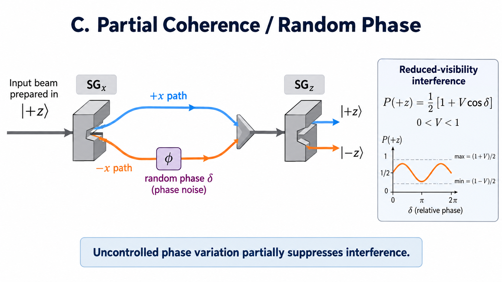
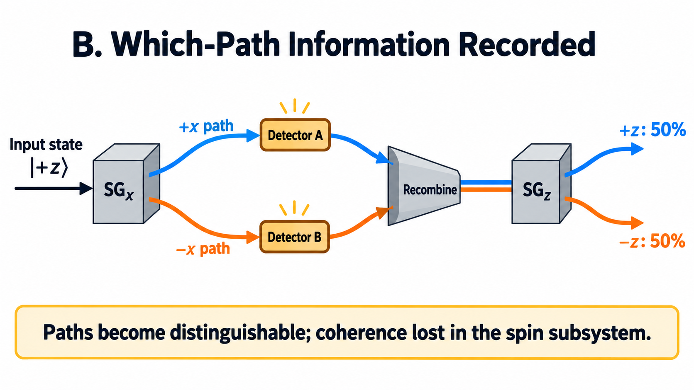

# Part 3: Quantum Interference

## Activity 3: Phase uncertainty in a Stern–Gerlach interferometer

### Goals

- Connect off-diagonal coherence to observable interference fringes.
- Predict the effect of uncontrolled phase shifts between two Stern–Gerlach paths.
- Distinguish **phase averaging** from **which-path measurement** while recognizing that both can produce the same reduced spin density matrix.

### Specific Tasks

1. Model a spin prepared as $|+z\rangle$ and split coherently into $|+x\rangle$ and $|-x\rangle$ paths.
2. Include a controllable relative phase $\delta$ between paths before **ideal coherent recombination**.
3. Reuse the Part 1 phase-averaging model to include an additional random phase $\epsilon\in[-\Delta,\Delta]$ on each preparation.
4. Calculate the final $P(+z)$ as a function of $\delta$ for $\Delta=0$, $\pi/2$, and $\pi$.
5. Create **Figure 4** containing the three interference fringes and calculate their visibility.

### Physics Background

The first $x$-oriented Stern–Gerlach magnet resolves two components:

$$
|+z\rangle=\frac{1}{\sqrt{2}}\big(|+x\rangle+|-x\rangle\big).
$$

### Ideal coherent recombination

Assume the two paths are separated and then coherently recombined into the **same spatial mode** (with no residual path information). A controlled relative phase $\delta$ produces

$$
|\psi(\delta)\rangle=\frac{1}{\sqrt{2}}\big(|+x\rangle+e^{i\delta}|-x\rangle\big).
$$

The following diagram illustrates the idealized Stern–Gerlach interferometer. The two paths are recombined coherently, without recording which-path information.


*Figure A: Coherent Stern–Gerlach recombination. When the relative phase is zero, the initial $|+z\rangle$ state is recovered, and all particles exit through the $+z$ output of the final analyzer.*

The probability of a final $+z$ outcome is

$$
P(+z)=\frac{1}{2}(1+\cos\delta).
$$

Notice that the output probabilities depend on the **relative phase** between the two paths. When $\delta=0$, all particles emerge from the $+z$ output. When $\delta=\pi$, all particles emerge from the $-z$ output.

### Random phase and reduced visibility

Now let the actual phase be $\delta+\epsilon$, where the uncontrolled phase $\epsilon$ varies uniformly across preparations in $[-\Delta,\Delta]$.

On averaging,

$$
P(+z)=\frac{1}{2}\left[1+\frac{\sin\Delta}{\Delta}\cos\delta\right].
$$

For this **balanced, ideal** interferometer, the fringe visibility is

$$
V=\frac{P_{\max}-P_{\min}}{P_{\max}+P_{\min}}
=\left|\frac{\sin\Delta}{\Delta}\right|.
$$

The diagram below shows an interferometer in which one path acquires an uncontrolled relative phase. Unlike the ideal coherent case, the observed interference pattern has reduced visibility.



*Figure B: Partial coherence caused by random phase shifts. A fluctuating relative phase reduces the visibility of the interference fringes. Complete phase randomization removes the interference pattern.*

Equivalently, $V=2|\rho_{12}|$, **provided** $\rho$ is expressed in the intermediate $x$-path basis. A $z$-basis coherence element is not automatically the relevant one for a path interferometer.

### Code Stem

```python
plus_x = (up + down).unit()
minus_x = (up - down).unit()
P_out = qt.ket2dm(up)          # final +z detector


def path_state(phase):
    return (plus_x + np.exp(1j * phase) * minus_x).unit()


def output_probability(delta, Delta, N=1000, seed=42):
    rng = np.random.default_rng(seed)
    random_shifts = rng.uniform(-Delta, Delta, N)
    rho_out = sum(
        (qt.ket2dm(path_state(delta + eps)) for eps in random_shifts),
        start=0
    ) / N
    return (rho_out * P_out).tr().real

# Check one output:
print('Fully coherent:', output_probability(0, 0))

# TODO: sweep controlled delta from 0 to 2*pi and
# plot output_probability for Delta = 0, pi/2, pi.
# Compare with the analytical fringe formula.
```

**Computational suggestion:** The double loop over phases and many $\delta$ values is intentionally transparent, but may be slow in shared notebook systems. You can sample random offsets **once**, calculate their mean complex phase factor, and reuse that mean for every $\delta$—or have an LLM help vectorize the simulation. Explain any optimization you make; do not simply replace simulation results with the analytical curve.

### Figure 4: Interference fringe visibility

Plot the simulated $P(+z)$ versus controlled phase $\delta$, for all three phase-spread values, together with the analytical predictions.

Report the measured visibility for each curve; use a sufficiently fine phase grid to estimate extrema.

Compare your simulated interference patterns with the behavior illustrated in Figures A and B.

### Connecting to welcher Weg (conceptual extension, no new code required)

In the preceding simulation, coherence was reduced by introducing random relative phases. However, interference can also disappear when information about the particle's path becomes physically available.

Consider placing a detector in each arm of the Stern–Gerlach interferometer, as shown below.



*Figure C: Which-path measurement. Detectors record which intermediate path the particle followed. Even if the paths are subsequently recombined, the retained detector record makes the alternatives distinguishable and eliminates interference in the reduced spin state.*

A path detector may become entangled with the particle:

$$
|\Psi\rangle=\frac{1}{\sqrt{2}}\left(
|+x\rangle|D_+\rangle+
|-x\rangle|D_-\rangle
\right).
$$

If the detector is ignored, the reduced spin matrix in the $x$ basis is

$$
\rho_{\mathrm{spin}}=
\frac{1}{2}
\begin{pmatrix}
1 & \langle D_-|D_+\rangle\\
\langle D_+|D_-\rangle & 1
\end{pmatrix}.
$$

Orthogonal detector states ($\langle D_-|D_+\rangle=0$) give complete which-path distinguishability and remove the reduced spin coherence.

This mechanism differs from averaging classical random phases, even though the resulting spin density matrix can be identical.

A path detector does **not** need to be read by a person to establish physical distinguishability.

**Experimental qualification:** Merely letting the split paths converge on a detector is not enough to restore interference. The apparatus must erase residual spatial/path distinguishability and coherently recombine the modes. This exercise models that ideal limit.

---

## Questions to Consider

**5.** Explain why the interference pattern loses visibility as the random-phase range increases even though the probabilities of entering the two intermediate paths remain $1/2$. Connect your explanation to **off-diagonal density-matrix terms in the $x$ basis**.

**6.** Compare a phase-randomized ensemble with a system entangled with a which-path detector. How can these different mechanisms produce identical reduced spin density matrices? If the matrices are identical, could any measurement on the **spin alone** distinguish the mechanisms?

## What You Must Record

- **Figure 4:** Three labeled simulated interference fringes with analytical comparisons.
- Calculated visibility for $\Delta=0$, $\pi/2$, and $\pi$.
- Your answers to Questions 5–6.

---

## Final Submission Requirements (all parts)

Submit **one executable Jupyter notebook (`.ipynb`)**, completed using Colab, OnDemand, or VS Code. Include:

1. Your **analytical warm-up** and its QuTiP check.
2. **Four required figures**: Bloch-sphere ensembles; coherence versus phase spread; two-panel purity/measurement probabilities; interference fringes.
3. **Six numbered physics explanations**, clearly matched to Questions 1–6.
4. Numerical matrices / small tables explicitly requested in Parts 1–2, and fringe visibility values from Part 3.
5. All code necessary to regenerate the numerical results and plots; the notebook must run in order after dependency installation.
6. A brief **LLM-use statement** (what assistance you used and what you verified yourself).

**Evaluation emphasis:** physics predictions and interpretation (40%); accurate, labeled visualizations (30%); correct, validated calculations (20%); clarity and reproducibility (10%). Code elegance and the amount written without assistance are **not** grading objectives.

Before submitting, check that every numerical density matrix has trace approximately 1, is Hermitian, has nonnegative eigenvalues within numerical tolerance, and returns probabilities between 0 and 1.

