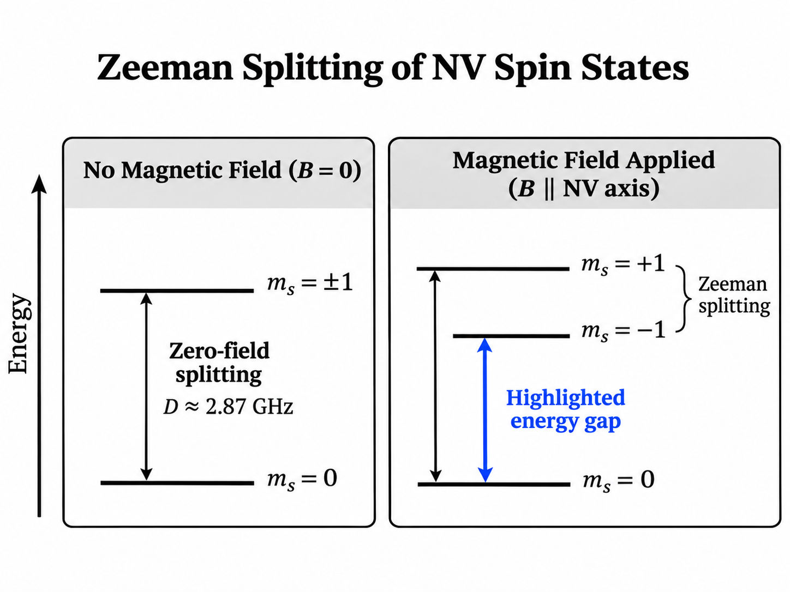
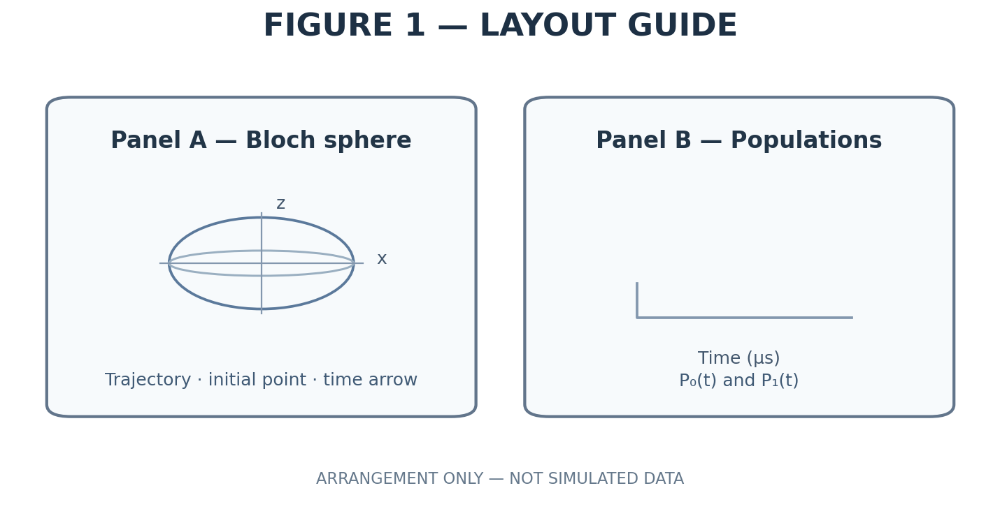

# Part 1: Larmor Precession and Quantum Phase

## Big Idea

A quantum state can evolve in time even when the probabilities of measuring its energy eigenstates remain constant.

In this activity, you will investigate **Larmor precession** of an NV-center electron spin in a static magnetic field. You will use QuTiP to simulate Schrödinger time evolution, visualize the motion of the spin state on the Bloch sphere, and examine how its measurement probabilities change with time.

The central question is:

**How can a quantum state change in time when the probabilities of measuring its spin along the $z$-axis remain constant?**

---

## Physical Background

### The NV Center in a Magnetic Field

Recall that we are modeling two states of the NV center's electronic ground state:

```math
|0\rangle\equiv|m_s=0\rangle,
\qquad
|1\rangle\equiv|m_s=-1\rangle.
```

These states form our computational basis.

An NV center has an intrinsic energy splitting between its ground-state spin levels. Even without an applied magnetic field, the $m_s=0$ level is separated from the $m_s=\pm 1$ levels. Applying a magnetic field along the NV axis changes the energy difference between the spin states through the **Zeeman effect**.

The magnetic field shifts the $m_s=+1$ and $m_s=-1$ levels in opposite directions. In this lab, we focus on the $m_s=0\leftrightarrow m_s=-1$ transition, treating it as an effective two-level system.


<p align="center">
  
</p>

If the magnetic field changes, the transition frequency between these two states also changes.

We will describe their relative phase evolution using the effective Hamiltonian

```math
\hat H=\frac{\hbar\omega}{2}\sigma_z,
```

where $\omega$ is the angular frequency of relative phase evolution. The Pauli-$z$ operator is

```math
\sigma_z=\begin{pmatrix}
1 & 0 \\
0 & -1
\end{pmatrix}.
```

We use illustrative angular frequencies of a few rad/µs to make the phase evolution easy to simulate and visualize. These are smaller than the NV center's physical gigahertz-scale transition frequencies; the investigation focuses on the mathematics of relative phase and precession.

### Relative Phase and Larmor Precession

Suppose the NV center is initially prepared in the equal superposition

```math
|\psi(0)\rangle=\frac{|0\rangle+|1\rangle}{\sqrt{2}}.
```

Under the Hamiltonian above, the state evolves as

```math
|\psi(t)\rangle=\frac{1}{\sqrt{2}}\left(e^{-i\omega t/2}|0\rangle+e^{i\omega t/2}|1\rangle\right).
```

Removing an overall global phase gives the physically equivalent state

```math
|\psi(t)\rangle\sim\frac{1}{\sqrt{2}}\left(|0\rangle+e^{i\omega t}|1\rangle\right).
```

The **relative phase** between the two basis states changes continuously with time. On the Bloch sphere, this produces a rotation around the $z$-axis.

The populations of the two states, however, remain constant:

```math
P_0(t)=|\langle 0|\psi(t)\rangle|^2,
\qquad
P_1(t)=|\langle 1|\psi(t)\rangle|^2.
```

Your task is to verify this behavior computationally and investigate what happens when the precession rate changes.

---

## Computational Investigation

Use the provided student notebook for this activity. It contains QuTiP imports, basis-state definitions, Pauli operators, time-evolution functions, and plotting tools.

You may use an LLM to generate or modify the Python code needed to carry out the investigation. **Your responsibility is to specify the physical model, predict its behavior, verify the numerical results, and explain the physics.**

### Step 1: Predict the Spin Evolution

Before running any simulations, consider the initial state

```math
|\psi(0)\rangle=\frac{|0\rangle+|1\rangle}{\sqrt{2}}
```

and Hamiltonian

```math
\hat H=\frac{\hbar\omega}{2}\sigma_z.
```

Record your predictions in the notebook:

1. Where will the initial state appear on the Bloch sphere?
2. What path will the Bloch vector follow as time increases?
3. Will $P_0(t)$ and $P_1(t)$ change during the evolution?
4. What will happen to the motion if $\omega$ is doubled?

**Do not run the simulation until you have recorded your predictions.**

### Step 2: Simulate Larmor Precession

Use `omega = 2*np.pi` rad/µs and `times1 = np.linspace(0, 2, 501)` in µs. This interval contains two full precession periods.

**Simulation requirements:** Construct `H1 = omega*sz/2` (numerical `H/ħ`); prepare `psi_plus`; use the shared `simulate_spin(H1, psi_plus, times1)` and store the resulting dictionary in `part1`. The dictionary must contain `times`, `states`, `p0`, `p1`, and `bloch`.

**Output:** A complete `part1` result dictionary; **no graph is required yet**. Use it to create Figure 1 in Step 3.

### Step 3: Generate Figure 1

**Figure 1 — Larmor Precession and Spin-State Populations**

Create **one figure containing two side-by-side panels**.

<p align="center">
  
</p>

*Layout only—not simulated results. Produce both panels using your own calculated data.*

#### Required Output — Figure 1

| Component | Required output |
|---|---|
| Overall title | Figure 1 — Larmor Precession and Spin-State Populations |
| Left panel | Bloch-sphere trajectory for `part1`, with x/y/z axes and initial state |
| Rotation indication | Time-direction arrow and labeled `omega` component along +z |
| Right panel | `P0(t)` and `P1(t)` plotted against the same `part1["times"]` |
| Axes | Time (µs), 0–2; Probability, 0–1 |
| Identification | Distinguishable curves, legend and descriptive panel titles |
| Caption | 1–2 sentences connecting precession to unchanged populations |

Use the instructor-provided `plot_bloch()` for the left panel, with `omega_z=omega, axis_unit=omega`. The helper draws the initial marker, trajectory, axes, and time arrow. Do not redefine it. Register the Matplotlib figure with `figures["Figure 1"] = fig1`.

### One Complete Example LLM Prompt — Figure 1

**This is the only fully written LLM prompt in the lab.** Study how it communicates existing notebook resources, physical data, plotting requirements, and constraints. You will construct your own prompts for all subsequent tasks.

```text
I am completing Part 1 of a QuTiP spin-dynamics lab.
My notebook already contains a simulation dictionary named part1,
the plot_bloch() helper, and a figures dictionary.
The result dictionary has times, states, p0, p1, and bloch.

Create Figure 1 as ONE Matplotlib figure with two side-by-side panels.
LEFT: a 3D Bloch sphere, using plot_bloch(ax, part1, ...), the
full 0–2 us trajectory, starting-state and time-direction markers,
and the positive-z omega rotation term (omega_z=omega,
axis_unit=omega).
RIGHT: plot part1["p0"] and part1["p1"] versus part1["times"].
Label Time (us), range 0–2, and Probability, range 0–1.
Include legend, panel titles, and readable labels for PDF export.
Store the figure in fig1 and register figures["Figure 1"] = fig1.
Reuse supplied functions. Do not redefine simulate_spin() or
plot_bloch(), or modify the physical model or simulation data.
```

Inspect the output against the figure specification and your predictions.

### Step 4: Investigate the Effect of Precession Frequency

Repeat with `omega_fast = 4*np.pi` rad/µs, the same initial state, and the same 501 samples over 0–2 µs. Store the results in `part1_fast`, using `simulate_spin()` rather than creating a new solver.

#### Required Output — Frequency Comparison

Print **one two-row numerical table**:

| ω (rad/µs) | Predicted period (µs) | Revolutions in 2 µs | Maximum population variation |
|---|---:|---:|---:|
| 2π | Calculated | Calculated | Calculated |
| 4π | Calculated | Calculated | Calculated |

The predicted period is `2*pi/abs(omega)`; revolutions equal the interval duration divided by the period. Population variation is the largest absolute change of either probability from its initial value. Additionally print the maximum probability-normalization error for each simulation. Write 1–2 sentences interpreting the table.

**No additional numbered figure is required.**

### AI Coding Guidance — Frequency Comparison

Construct your own prompt using the Figure 1 example as a model. Identify the two existing dictionaries, calculations, required table columns and units, and checks. Do not request a new graph or redundant solver.

## Numerical Verification

Before accepting your simulation, verify the following results.

### 1. State Normalization

For every simulated time,

```math
\langle\psi(t)|\psi(t)\rangle=1.
```

### 2. Population Conservation

Verify that

```math
P_0(t)+P_1(t)=1
```

throughout the simulation. Also check that neither population changes during free precession, within numerical precision.

### 3. Precession Period

The expected precession period is

```math
T=\frac{2\pi}{|\omega|}.
```

Compare the period observed in your Bloch-sphere simulation with this analytical prediction.

### 4. Bloch-Vector Behavior

Calculate the expectation values

```math
\langle\sigma_x\rangle,\qquad
\langle\sigma_y\rangle,\qquad
\langle\sigma_z\rangle.
```

Verify that the Bloch vector remains on the equator and that its length remains approximately 1.

Record the numerical results of your verification in the notebook. If your results do not agree with the predictions, investigate the discrepancy before continuing.

---

## Physics Analysis

Answer the following questions **independently** in the designated Markdown cells of your notebook.

**Question 1 — Time Evolution Without Population Transfer**

Your Bloch sphere shows the quantum state evolving continuously in time, but your population graph shows constant values of $P_0$ and $P_1$.

Explain how these two observations are consistent. In your answer, distinguish between the relative phase of a quantum superposition and the probabilities of measuring its basis states.

**Question 2 — Magnetic Fields and Precession**

Increasing the precession frequency changes how rapidly the Bloch vector moves around the $z$-axis.

Explain why changing the energy difference between the two basis states changes the rate of relative phase accumulation. How does this connect to the effect of a magnetic field on the NV-center spin?

Your answers should refer to the physical behavior observed in your simulations, not simply restate equations.

**Do not use an LLM to generate your physics-analysis answers.**

---

## AI Development Record — Part 1

Document one meaningful AI interaction from this activity in the designated section of your student notebook. Include:

1. **Objective:** What were you trying to accomplish?
2. **Prompt:** Copy the actual prompt you submitted.
3. **AI Contribution:** What did the LLM generate or suggest?
4. **Verification:** How did you check that its result was physically and numerically correct?
5. **Revision (if applicable):** What did you change or improve?

If you did not use an LLM, describe your independent development and verification process. You do not need to include your complete conversation history.

---

## Part 1 Completion Checklist

Before moving to Part 2, confirm that you have:

- [ ] Completed the prediction questions before running the simulations.
- [ ] Simulated Larmor precession for both values of $\omega$.
- [ ] Generated Figure 1 with the required Bloch-sphere trajectory and population plot.
- [ ] Calculated the Bloch-vector components and verified population conservation.
- [ ] Compared the simulated precession periods with analytical predictions.
- [ ] Answered both physics-analysis questions independently.
- [ ] Completed your Part 1 AI Development Record entry.

**You are now ready for Part 2: Microwave Driving and Rabi Oscillations.**

In Part 1, the Hamiltonian changed the relative phase of the quantum state without changing its populations. In Part 2, you will introduce microwave driving and investigate how an applied field can transfer population between the two states.
