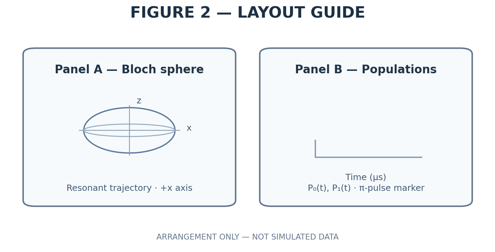
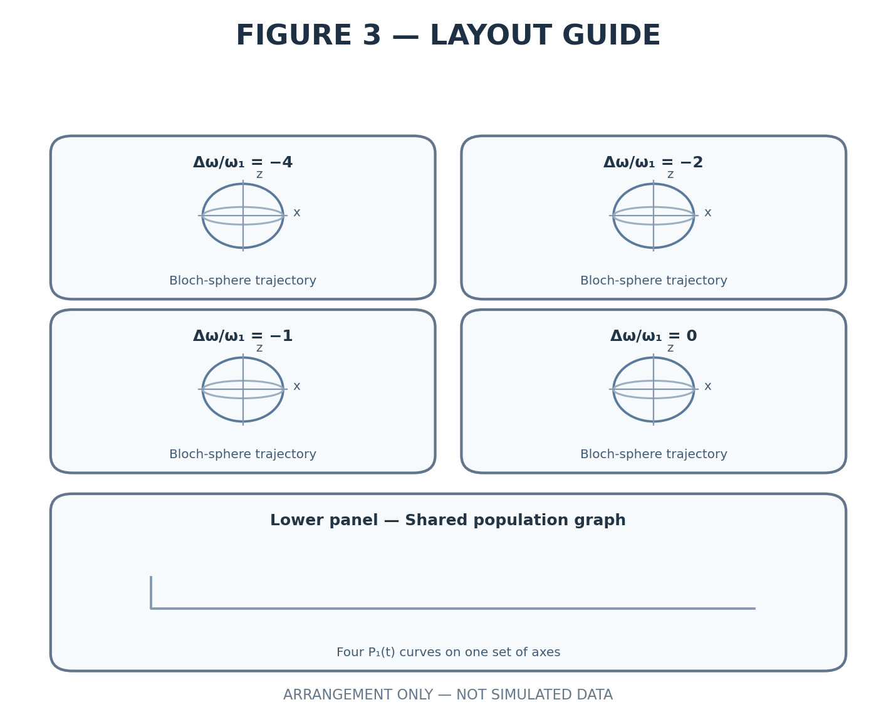

# Part 2: Microwave Driving and Rabi Oscillations

## Big Idea

In Part 1, you observed how a quantum superposition accumulates relative phase while the probabilities of measuring its two basis states remain unchanged.

We can do something more powerful: **use microwave radiation to deliberately transfer population between two quantum states**. This controlled evolution produces *Rabi oscillations*.

In this activity, you will simulate microwave-driven dynamics of an NV-center spin, identify the pulse duration required to flip the spin, and investigate what happens when the microwave frequency does not match the spin transition frequency.

**Central question:** How does an oscillating microwave field control the state of an NV center, and why does this control become less effective when the drive is detuned?

---

## Physical Background

### Microwave Driving: Natural Frequency, Applied Frequency, and Resonance

We continue to model two ground-state spin levels of the NV center:

```math
|0\rangle\equiv|m_s=0\rangle,\qquad |1\rangle\equiv|m_s=-1\rangle.
```

The energy gap defines the NV center's **natural transition angular frequency**:

```math
\omega_0=\frac{|E_1-E_0|}{\hbar}.
```

A transverse microwave magnetic field oscillates at an **applied angular frequency** $\omega$ and can drive transitions between these states. The relevant frequency difference is called **detuning**:

```math
\boxed{\Delta\omega=\omega-\omega_0.}
```

- **On resonance:** $\omega=\omega_0$, so $\Delta\omega=0$. An appropriately timed microwave pulse can completely flip the spin.
- **Near resonance:** The two frequencies are similar, but population transfer is incomplete.
- **Far from resonance:** The mismatch is large relative to the coupling strength; only a small population transfer is possible.

Here $\omega_1$ denotes the **microwave coupling strength** (in rad/$\mu$s), not another microwave frequency. All three quantities are angular frequencies, but they play different physical roles.

### From an Oscillating Field to the Rabi Formula

The actual microwave field varies in time, for example as $B_x(t)=B_1\cos(\omega t)$. The corresponding *laboratory-frame* two-level Hamiltonian has the form

```math
\hat H_{\mathrm{lab}}(t)=\frac{\hbar\omega_0}{2}\sigma_z
+\hbar\omega_1\cos(\omega t)\sigma_x.
```

The constant $\omega_1$ is defined here so that the **resonant Rabi angular frequency** is $\omega_1$ under the rotating-wave approximation. The microwave field itself is genuinely time-dependent, even when its amplitude is constant during a pulse.

For a drive close to resonance and weak compared with the microwave carrier frequency, the probability of a transition from $|0\rangle$ to $|1\rangle$ after a pulse of duration $t$ is approximately

```math
\boxed{P_{0\rightarrow1}(t)=
\frac{\omega_1^2}{(\omega-\omega_0)^2+\omega_1^2}
\sin^2\!\left(
\frac{\sqrt{(\omega-\omega_0)^2+\omega_1^2}}{2}t
\right).}
```

This is the **driven Rabi formula**. Notice that the mismatch between the natural frequency and the applied frequency appears in both the maximum population transfer and the oscillation rate:

```math
P_{0\rightarrow1}^{\max}=
\frac{\omega_1^2}{(\Delta\omega)^2+\omega_1^2},
\qquad
\Omega=\sqrt{(\Delta\omega)^2+\omega_1^2}.
```

At resonance, $\Delta\omega=0$: the maximum probability is 1, and the spin oscillates at angular frequency $\omega_1$. When $|\Delta\omega|$ increases, the maximum transfer decreases while $\Omega$ increases.

### Why We Can Use a Time-Independent Hamiltonian

We have not yet derived the mathematics of the rotating frame. We will do that in a later lesson. For now, accept the following **effective model** of the *slow spin dynamics relative to the microwave drive*:

```math
\boxed{\hat H_{\mathrm{eff}}=
-\Delta\omega\,\hat S_z+\omega_1\hat S_x
=\frac{\hbar}{2}\bigl(-\Delta\omega\,\sigma_z+\omega_1\sigma_x\bigr).}
```

This is a **time-independent approximation during a constant-amplitude microwave pulse**, not the literal laboratory-frame Hamiltonian. A rotating-frame transformation, followed by the rotating-wave approximation, produces it when the drive is near resonance and not too strong. You will derive that connection later; in this lab, you will study the consequences using the time-independent techniques from class.

In the textbook's static-field problem, the Hamiltonian also contains $S_z$ and $S_x$ terms. The mathematics of the rotation is identical, but the *meaning of the terms* is different here:

- The effective $z$ coefficient is $-\Delta\omega=\omega_0-\omega$, representing **frequency mismatch**, not an extra applied static field.
- The effective $x$ coefficient is $\omega_1$, representing microwave coupling.

In matrix form,

```math
\hat H_{\mathrm{eff}}=\frac{\hbar}{2}
\begin{pmatrix}
-\Delta\omega & \omega_1\\
\omega_1 & \Delta\omega
\end{pmatrix}.
```

We use time in $\mu$s and angular frequencies in rad/$\mu$s. In QuTiP, enter $\hat H/\hbar$ directly (without a separate numerical factor of $\hbar$). The effective Bloch trajectories produced in this lab are **rotating-frame trajectories**, not the full gigahertz-speed laboratory motion.

### Resonant Driving: A Spin Flip

When the applied frequency matches the natural frequency, $\omega=\omega_0$ and $\Delta\omega=0$, so the effective Hamiltonian simplifies to

```math
\hat H_{\mathrm{res}}=\frac{\hbar\omega_1}{2}\sigma_x.
```

Starting from $|0\rangle$, the microwave field drives a rotation about the $x$-axis of the Bloch sphere. The population of $|1\rangle$ is

```math
P_1(t)=\sin^2\left(\frac{\omega_1t}{2}\right).
```

After a time

```math
t_\pi=\frac{\pi}{\omega_1},
```

the spin has rotated through an angle $\pi$ and the population has transferred completely from $|0\rangle$ to $|1\rangle$. This is called a **$\pi$-pulse**. A shorter $\pi/2$-pulse prepares an equal superposition.

### Off-Resonant Driving

When $\Delta\omega\ne0$, the Hamiltonian contains both $\sigma_x$ and $\sigma_z$ terms:

```math
\hat H_{\mathrm{off}}=\frac{\hbar}{2}\left(-\Delta\omega\,\sigma_z+\omega_1\sigma_x\right).
```

The Bloch vector rotates around a tilted effective axis in the $x$–$z$ plane, just as in the textbook's general-direction field problem. The difference between the two energy eigenvalues defines the generalized oscillation angular frequency

```math
\Omega=\sqrt{(\Delta\omega)^2+\omega_1^2}.
```

The driven Rabi formula given earlier, evaluated for our initial $|0\rangle$ state, can be written in terms of detuning as

```math
P_{0\rightarrow1}(t)=
\frac{\omega_1^2}{(\Delta\omega)^2+\omega_1^2}
\sin^2\!\left(\frac{\sqrt{(\Delta\omega)^2+\omega_1^2}}{2}t\right).
```

The maximum population transfer is

```math
P_{0\rightarrow1}^{\max}=\frac{\omega_1^2}{(\Delta\omega)^2+\omega_1^2}.
```

Thus **increasing the magnitude of detuning increases the generalized oscillation frequency while decreasing the maximum probability of a complete spin flip**.

<p align="center">
  
</p>


---

## Computational Investigation A: Resonant Microwave Driving

### Step 1: Predict the Evolution

Start with the initial state

```math
|\psi(0)\rangle=|0\rangle
```

and the resonant Hamiltonian

```math
\hat H_{\mathrm{res}}=\frac{\hbar\omega_1}{2}\sigma_x.
```

**Record your predictions before running the simulation:**

1. Where does the spin begin on the Bloch sphere, and about which axis will it rotate?
2. What should happen to $P_0(t)$ and $P_1(t)$?
3. What duration should produce a complete spin flip? What happens to that duration if the microwave strength doubles?

### Step 2: Simulate Resonant Rabi Oscillations

Use `omega1 = 2*np.pi` rad/µs, `detuning = 0`, and **1,001** evenly spaced samples from 0 to 2 µs. Prepare `|0⟩`, build the resonant Hamiltonian with the supplied operators, and use `simulate_spin()` to calculate the populations and Bloch vector. Store the simulation in `part2_res`.

Determine the first π-pulse duration from the analytical formula and the simulated first population maximum.

**Required output from Step 2:** A complete simulation-result dictionary and the first π-pulse duration. Generate the figure in Step 3.

### Step 3: Generate Figure 2

**Figure 2 — Resonant Rabi Oscillations**

Create **one figure with two side-by-side panels**.

<p align="center">
  
</p>

*Layout only—not the numerical result. Generate your own trajectories and curves.*

#### Required Output — Figure 2

| Component | Required content |
|---|---|
| Overall title | Figure 2 — Resonant Rabi Oscillations |
| Left panel | 3D Bloch trajectory from `|0⟩` at the north pole, with initial marker and time direction |
| Rotation-axis term | `omega1` along +x, using the supplied `plot_bloch()` helper |
| Right panel | `P0(t)` and `P1(t)` against time |
| Axes | Time (µs) 0–2; Probability 0–1 |
| π-pulse marker | Labeled vertical dashed line at first π-pulse time |
| Identification | Distinct curves, legend, titles, north/south poles identifiable |
| Caption | 1–2 sentences connecting Bloch rotation to population transfer |

Use `omega_x=omega1, axis_unit=omega1` for the left panel. Plot both populations over the full interval on the right panel. Register the final figure using `figures["Figure 2"] = fig2`.

### AI Coding Guidance — Figure 2

**Construct your own prompt.** The complete Figure 1 prompt was your worked example. Specify the existing result dictionary and helper, two-panel arrangement, x-axis term, π-pulse reference line, and figure registration. Confirm that the generated plot meets every requirement. Do not ask the LLM to redefine the shared solver or plotting utility.

### Step 4: Change the Microwave Strength

Repeat with `omega1_fast = 4*np.pi` rad/µs and zero detuning, keeping the initial state and time interval unchanged. Store results in `part2_fast`.

#### Required Output — Coupling-Strength Comparison

Print **one two-row numerical table**:

| ω1 (rad/µs) | Predicted first tπ (µs) | Simulated first tπ (µs) | Maximum P1 |
|---|---:|---:|---:|
| 2π | Calculated | Calculated | Calculated |
| 4π | Calculated | Calculated | Calculated |

Report times and probabilities to at least three decimal places. Interpret the relationship between coupling strength and pulse duration in 1–2 sentences.

**No additional numbered figure is required.** When requesting coding assistance, construct your own prompt that identifies the result dictionaries, desired calculations, output table, and units.

## Computational Investigation B: Approaching Resonance

### Step 5: Predict the Effect of Detuning

Return to $\omega_1=2\pi\ \mathrm{rad/\mu s}$ and hold the coupling strength fixed. Approach resonance by decreasing the **magnitude** of the microwave detuning. For consistency with our earlier Bloch-axis diagrams, choose the following negative values of $\Delta\omega$ (the applied drive begins below the natural transition frequency):

| Case | $\Delta\omega/\omega_1$ | Microwave frequency | Interpretation |
|---|---:|---|---|
| A | $-4$ | $\omega=\omega_0-4\omega_1$ | Strong detuning |
| B | $-2$ | $\omega=\omega_0-2\omega_1$ | Moderate detuning |
| C | $-1$ | $\omega=\omega_0-\omega_1$ | Smaller detuning |
| D | $0$ | $\omega=\omega_0$ | On resonance |

For these values, the effective $z$ coefficient $-\Delta\omega$ is positive and decreases in the ratio $4:2:1:0$. The effective $x$ coefficient stays fixed at $\omega_1$.

**Before simulating, predict:** (1) which trajectory will remain closest to the north pole, (2) which will reach the south pole, (3) how the rotation axis tilts as the microwave frequency approaches $\omega_0$, and (4) whether the population oscillations speed up or slow down.

### Step 6: Simulate the Four Detuning Values

Use `omega1 = 2*np.pi` rad/µs and detuning ratios `-4, -2, -1, 0`. For each ratio, initialize `|0⟩` and simulate **1,001 points** over 0–2 µs. Use the same `nv_hamiltonian(detuning, omega1)` and `simulate_spin()` helpers. Store four standardized result dictionaries in `detuning_results`, keyed by the **signed dimensionless** ratios.

The `detuning` argument is `Δω = ω - ω0`; `nv_hamiltonian()` supplies the negative sign on the effective σz term.

**Output from Step 6:** Four result dictionaries, **not** four independent figures.

### Step 7: Generate Figure 3

**Figure 3 — Approaching Resonance: Bloch-Sphere Trajectories and Spin-Flip Probabilities**

Create **one combined figure** with a 2×2 grid of Bloch spheres above a single full-width population-comparison plot.

<p align="center">
  
</p>

*This guide defines only the panel arrangement; trajectories and curves must come from your simulations.*

#### Required Output — Figure 3

| Component | Required output |
|---|---|
| Title | Figure 3 — Approaching Resonance |
| Four Bloch spheres | 2×2 grid in signed detuning-ratio order −4, −2, −1, 0 |
| Each sphere | Initial `|0⟩`, time direction, x/y/z labels, same camera angle |
| Effective z term | `-Δω` component along +z, relative lengths 4:2:1:0 |
| Effective x term | `ω1` component along +x, equal lengths on every sphere |
| Shared graph | Four `P1(t)` curves on the same axes |
| Axes | Time (µs) 0–2; P1(t) 0–1 |
| Legend | Distinguishes all four signed detunings |
| Caption | 2–3 sentences on axis tilt, oscillation amplitude, and frequency |

Use `plot_bloch()` for each sphere with `omega_z=-ratio*omega1`, `omega_x=omega1`, `axis_unit=omega1`, and `axis_scale=0.28`. Maintain consistent viewing angles. The component arrows represent effective **Hamiltonian coefficients**, not literal applied laboratory magnetic-field vectors; their lengths are **not normalized Bloch vectors**.

Register the combined figure as `figures["Figure 3"] = fig3`.

### AI Coding Guidance — Figure 3

**Create your own prompt.** Make it precise enough for an LLM to identify the four data dictionaries, required 2×2+1 arrangement, reusable plotting helper, common arrow scaling, labels, shared graph, and registration. Evaluate the result against the layout guide and output specification. Do not request a replacement notebook or solver.

### Step 8: Report and Interpret Detuning Results

Print **one four-row table**:

| Δω/ω1 | Maximum P1 (simulation) | Maximum P1 (theory) | Generalized Ω (rad/µs) |
|---:|---:|---:|---:|
| −4 | Calculated | Calculated | Calculated |
| −2 | Calculated | Calculated | Calculated |
| −1 | Calculated | Calculated | Calculated |
| 0 | Calculated | Calculated | Calculated |

Calculate the simulated maximum over **all sampled times**, not just the final time. Compute theoretical `P1,max = 1/(1+ratio**2)` and `Ω = omega1*sqrt(1+ratio**2)`, reporting probabilities to three decimal places and Ω in rad/µs. Explain in 2–3 sentences why oscillations become larger but slower as detuning approaches zero.

**No additional graph is required.** Construct your own prompt if you need coding assistance.

## Numerical Verification

Before accepting Figures 2 and 3, verify the following:

### 1. State Normalization and Probabilities

For every simulation, confirm that

```math
\langle\psi(t)|\psi(t)\rangle\approx1,
\qquad P_0(t)+P_1(t)\approx1.
```

All probabilities must lie between 0 and 1.

### 2. Resonant $\pi$-Pulse

For $\omega_1=2\pi\ \mathrm{rad/\mu s}$, the predicted first spin flip occurs at

```math
t_\pi=0.5\ \mathrm{\mu s}.
```

Verify that $P_1(t_\pi)$ is approximately 1. When $\omega_1$ is doubled, verify that the first $\pi$-pulse duration is approximately halved.

### 3. Four Detuning Values and Maximum Population Transfer

Check the simulated maximum population against

```math
P_{1,\max}=\frac{\omega_1^2}{\omega_1^2+(\Delta\omega)^2}.
```

For $\Delta\omega=-4\omega_1,\ -2\omega_1,\ -\omega_1,\ 0$, the predicted maximum probabilities are, respectively,

```math
\frac{1}{17}\approx0.0588,\qquad
\frac15=0.20,\qquad
\frac12=0.50,\qquad
1.
```

Small numerical differences due to time sampling are acceptable. The time interval must be long enough, and sampling sufficiently fine, to capture the peaks.

### 4. Generalized Rabi Frequency

Compare the oscillation frequencies with

```math
\Omega=\sqrt{\omega_1^2+(\Delta\omega)^2}.
```

Confirm that the oscillations become **slower** as the magnitude of detuning decreases toward zero while microwave coupling remains fixed, even as population transfer becomes more complete.

Record your numerical results and briefly identify any discrepancies.

---

## Physics Analysis

Answer these two questions **independently** in the designated Markdown cells of your notebook. Do not use an LLM to generate the answers.

**Question 3 — Resonant Spin Control**

In Part 1, the spin accumulated relative phase without changing its $|0\rangle$ and $|1\rangle$ populations. In this activity, resonant microwave driving caused those populations to oscillate. Explain the difference in terms of the Hamiltonian and the axis of rotation on the Bloch sphere. Why can a resonant $\pi$-pulse completely flip the spin?

**Question 4 — Approaching Resonance and Magnetometry**

Use your **four trajectories and population curves** to explain how decreasing detuning toward resonance changes the effective rotation axis, the maximum population transfer, and the oscillation frequency. Then consider an NV center exposed to a changing magnetic field while the microwave frequency is held fixed. Explain how the resulting change in detuning could provide information about the magnetic field.

Your answers should use evidence from Figures 2 and 3, not simply repeat the formulas.

---

## AI Development Record — Part 2

Document **one meaningful AI interaction** from this part in the designated AI Development Record section of your notebook. Include:

1. **Objective:** What did you want the code to accomplish?
2. **Prompt:** Your actual prompt to the LLM.
3. **AI Contribution:** What did it generate or suggest?
4. **Verification:** How did you compare its output with physical predictions or analytical limits?
5. **Revision (if applicable):** What did you improve after testing?

You do not need to submit your full AI conversation. If you worked without an LLM, explain how you developed and checked your code independently.

---

## Part 2 Completion Checklist

Before moving to Part 3, confirm that you have:

- [ ] Recorded predictions before the resonant and off-resonant simulations.
- [ ] Completed the resonant and doubled-strength Rabi simulations.
- [ ] Generated **Figure 2** with a Bloch-sphere trajectory and two population curves.
- [ ] Identified and verified the first $\pi$-pulse duration.
- [ ] Simulated all four detuning values in order from strong detuning toward resonance.
- [ ] Generated **Figure 3** with four separate Bloch-sphere trajectories and four population curves.
- [ ] Checked normalization, the four predicted maximum transfer values, and the generalized oscillation frequencies.
- [ ] Answered both physics-analysis questions independently.
- [ ] Completed the Part 2 AI Development Record entry.

**Next: Part 3 — Optical Readout and NV Magnetometry.** You have examined spin evolution at four discrete microwave detunings. Next, you will sweep the microwave frequency through a continuous range around resonance while keeping the pulse duration fixed. Instead of displaying only spin populations, you will convert the simulated final populations into predicted red fluorescence. This will produce a simplified pulsed-ODMR spectrum and show how a magnetic-field-induced resonance shift can be measured.

**Important distinction for Part 3:** The maximum spin-flip probability calculated above is not necessarily the probability at a particular fixed pulse duration. For the frequency sweep, you will use the full time-dependent population $P_1(\tau)$ evaluated at the *same* microwave pulse duration for every detuning.
