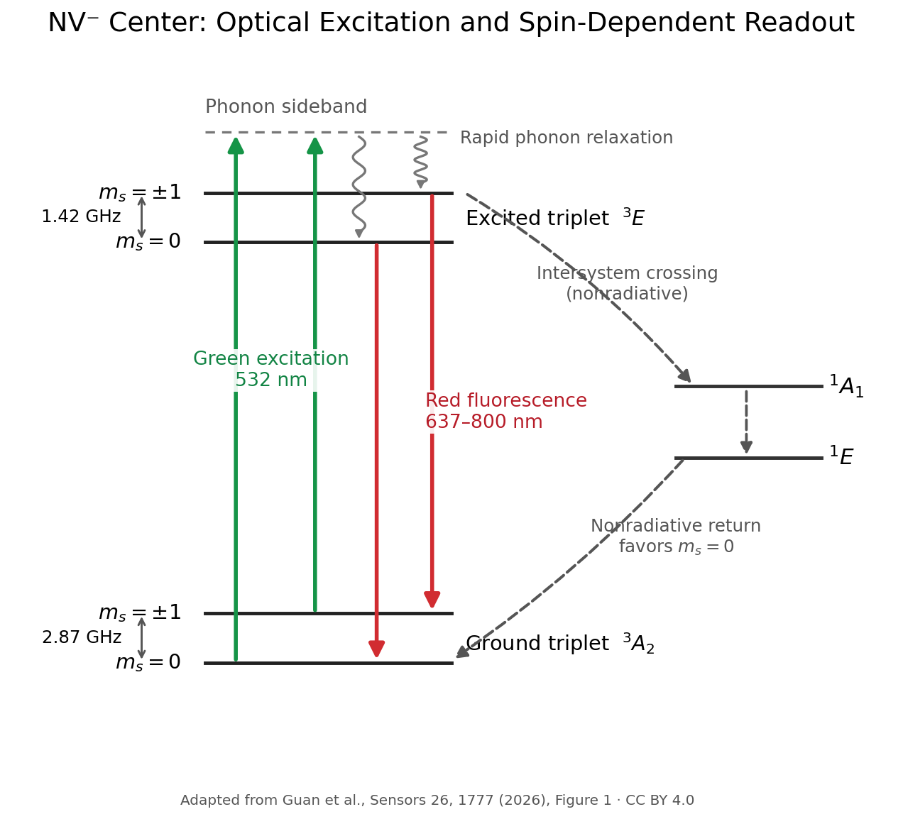

# Part 3: Optical Readout and NV Magnetometry

## Big Idea

In Parts 1 and 2, you simulated the evolution of an NV-center spin and calculated the probabilities of finding it in the states $|0\rangle$ and $|1\rangle$.

In Part 2, you discovered that the probability of a spin flip depends on how closely the microwave frequency matches the transition frequency between these states.

But how can we measure this behavior experimentally?

One of the most useful properties of NV centers is that **their electron spin states influence the amount of red fluorescence emitted when the diamond is illuminated with green laser light**.

In this final activity, you will use the quantum dynamics from Part 2 to simulate a microwave-frequency sweep and predict the resulting red fluorescence.

You will then investigate how a changing magnetic field shifts the resonance, connecting your simulation to **NV-diamond magnetometers being developed by students in QLab**.

**Central question: How can measuring red fluorescence while sweeping microwave frequency allow us to detect a magnetic field?**

---

## Physical Background

### Optical Initialization and Readout

NV centers can be excited using green laser light, typically at a wavelength of approximately $532\,\mathrm{nm}$.

After excitation, the NV center can return to its electronic ground state by emitting red fluorescence.

However, the amount of fluorescence depends on the electron spin state:

- The $m_s=0$ state produces relatively strong red fluorescence.
- The $m_s=-1$ state produces weaker red fluorescence.

This difference occurs because the $m_s=-1$ state has a greater probability of undergoing *intersystem crossing* into metastable singlet states. Some of the energy is subsequently released through nonradiative relaxation rather than the emission of detectable red photons.

Green illumination also preferentially initializes the electron spin into the $m_s=0$ state.

These properties allow researchers to prepare, manipulate, and measure the NV spin using a sequence of optical and microwave pulses.

<p align="center">
  
</p>

*Reference diagram: NV-center optical cycle, adapted from Figure 1 of Guan et al., “Frequency Locking Method for Frequency Standards Based on Diamond NV Centers,”* Sensors *26 (2026), 1777. [Original article and figure](https://doi.org/10.3390/s26061777). Reproduced in adapted form under [CC BY 4.0](https://creativecommons.org/licenses/by/4.0/).*

### The Experimental Measurement Sequence

Our simplified measurement consists of three steps:

1. **Initialize:** Use green laser light to prepare the NV spin predominantly in $|0\rangle$.
2. **Manipulate:** Apply a microwave pulse to drive transitions between $|0\rangle$ and $|1\rangle$.
3. **Read out:** Illuminate the NV center again with green light and collect red fluorescence.

We repeat this sequence while varying the microwave frequency.

For this investigation, the microwave pulse duration and coupling strength remain fixed. Only the microwave frequency changes.

The measured fluorescence allows us to infer how effectively the microwave pulse transfers population between the spin states.

### Connecting Quantum Populations to Fluorescence

Recall that the quantum state can be written as

```math
|\psi(\tau)\rangle=a(\tau)|0\rangle+b(\tau)|1\rangle.
```

The probabilities of finding the spin in either state after a microwave pulse of duration $\tau$ are

```math
P_0(\tau)=|a(\tau)|^2,
\qquad
P_1(\tau)=|b(\tau)|^2.
```

We will use a simplified fluorescence model:

```math
\boxed{F=F_0P_0+F_1P_1}
```

where:

- $F_0$ is the expected number of detected red photons during the readout window when the spin is in $|0\rangle$.
- $F_1$ is the expected number of detected red photons during the readout window when the spin is in $|1\rangle$.

Because the $|0\rangle$ state produces more fluorescence,

```math
F_0>F_1.
```

For this activity, use the illustrative values

```math
F_0=100,\qquad F_1=70.
```

These values represent expected detected photons per readout window and are not measurements of a particular NV center.

Since the probabilities add to one, we can rewrite the fluorescence model as

```math
\boxed{F=F_0-(F_0-F_1)P_1}
```

Notice that increasing the probability of finding the NV center in $|1\rangle$ decreases the expected fluorescence.

Our simulation will describe coherent spin evolution followed by optical readout. We will not simulate the complete optical excitation and relaxation processes.

---

## Microwave Frequency and Resonance

In Part 2 you studied a **driven** spin. The NV transition has a natural angular frequency $\omega_0$, while the applied microwave has angular frequency $\omega$. Their difference is the **detuning**:

```math
\boxed{\Delta\omega=\omega-\omega_0.}
```

When $\omega=\omega_0$, the drive is resonant. We introduced the actual oscillating microwave field and then adopted the approximate **time-independent effective Hamiltonian** for the spin dynamics relative to the drive:

```math
\hat H_{\mathrm{eff}}=
\frac{\hbar}{2}\left(-\Delta\omega\,\sigma_z+\omega_1\sigma_x\right).
```

The full driven system is time-dependent in the laboratory. The rotating frame and rotating-wave approximation explain the connection; you will derive these ideas in class soon. For this lab, the supplied effective Hamiltonian lets you apply the time-independent methods you already know.

In Part 2, you examined four discrete frequencies. Now you will sweep the microwave frequency **continuously across the resonance**, calculate the final spin population for a fixed pulse duration, and predict the corresponding red fluorescence. This is a simplified *pulsed optically detected magnetic resonance* (ODMR) spectrum.

### Choosing the Microwave Pulse Duration

Keep the microwave coupling fixed at

```math
\omega_1=2\pi\ \mathrm{rad/\mu s}.
```

The resonant $\pi$-pulse duration is

```math
\tau_\pi=\frac{\pi}{\omega_1}=0.5\ \mu\mathrm{s}.
```

Use this **same** duration at every microwave frequency. The driven Rabi formula is

```math
P_{0\rightarrow1}(\tau)=
\frac{\omega_1^2}{(\omega-\omega_0)^2+\omega_1^2}
\sin^2\!\left(
\frac{\sqrt{(\omega-\omega_0)^2+\omega_1^2}}{2}\tau
\right).
```

For the frequency sweep, evaluate $P_1$ at the **fixed pulse duration**, not at the different maximum-transfer time for each detuning. The expected fluorescence is

```math
F(\omega)=F_0-(F_0-F_1)P_1(\tau;\omega).
```

---

## Computational Investigation A: Optical Readout and Frequency Sweep

### Step 1: Predict the Fluorescence Spectrum

Before running any simulations, consider the following situation:

An NV center is initialized in $|0\rangle$. A microwave pulse of fixed duration $\tau_\pi$ is applied, and the resulting fluorescence is measured.

The experiment is repeated while the microwave frequency $\omega$ is swept through the natural frequency $\omega_0$.

**Record your predictions in the notebook:**

1. When the microwave frequency is far from resonance, will the fluorescence be closer to $F_0$ or $F_1$?
2. What should happen to the fluorescence as the microwave frequency approaches resonance?
3. At what microwave frequency do you expect the fluorescence to reach its minimum?

Do not run the simulation until you have recorded your predictions.

### Step 2: Simulate a Microwave-Frequency Sweep

Keep `omega1 = 2*np.pi` rad/µs and pulse duration `tau = 0.5` µs, **fixed at every applied frequency**. Use 201 evenly spaced drive-frequency offsets from `-4*omega1` to `+4*omega1` relative to the **original** natural transition frequency, including zero.

For each frequency offset: calculate detuning, build the effective `nv_hamiltonian()`, initialize `|0⟩`, use `simulate_spin()` over `[0, tau]`, extract final `P0` and `P1`, and convert these using `fluorescence()`.

#### Required Output — Original Frequency-Sweep Data

Produce a `part3_base` dictionary containing **four aligned 201-element arrays**:

| Array | Contents |
|---|---|
| `drive_offsets` | Applied angular-frequency offsets relative to the original transition (rad/µs) |
| `p0` | Final P0 after the fixed-duration pulse |
| `p1` | Final P1 after the fixed-duration pulse |
| `fluorescence` | Expected detected red photons per readout window |

The shared `sweep_fluorescence()` helper must also retain each `simulate_spin()` result in `simulations` for verification. **Do not generate a separate numbered figure yet.**

### Step 3: Inspect the Initial ODMR Spectrum

Convert angular-frequency offsets into ordinary frequency offsets in MHz using

```math
\Delta f=\frac{\Delta\omega}{2\pi}.
```

With angular-frequency units of rad/µs, the plotted offsets range from **−4 to +4 MHz**. Identify and print the **original central resonance offset** (MHz) and the corresponding minimum fluorescence (expected photons per readout). A temporary plot is optional but not a required numbered figure.

Because the pulse duration is fixed, the pulsed-ODMR spectrum may have oscillatory sidelobes away from resonance. Find the **central resonance**, rather than relying on an arbitrary off-center local minimum.

**AI guidance:** Formulate your own prompt identifying the existing notebook functions, input range and units, the data structure, and the printed result you require. Do not ask for an independent solver.

## Computational Investigation B: Detecting a Magnetic Field

### Step 4: Predict the Effect of a Changing Magnetic Field

In Part 1, you learned that a magnetic field applied along the NV axis changes the energy separation between the spin states.

This changes the NV natural transition frequency.

If the applied magnetic field changes while the microwave frequency remains fixed, the detuning $\Delta\omega=\omega-\omega_0$ also changes.

For this investigation, we will simulate a magnetic-field change by shifting the NV natural transition angular frequency by

```math
\delta\omega_0=\omega_1.
```

This is an illustrative shift selected to make the effect visible. You do not need to calculate the corresponding magnetic-field strength.

Before running the simulation, predict:

1. What happens to the resonance frequency when the NV natural transition frequency increases?
2. Will the fluorescence minimum move toward a higher or lower applied microwave frequency?
3. Will the magnetic-field change necessarily alter the maximum achievable spin-flip probability at resonance?

### Step 5: Simulate the Resonance Shift

Use the imposed natural transition shift `nv_shift = omega1` with the **exact same original** `drive_offsets` array. At each drive frequency, the shifted detuning is

```math
\Delta\omega'=\Delta\omega-\delta\omega_0.
```

Recalculate the final populations and fluorescence with the same coupling and 0.5 µs pulse. Keep the original spectrum unchanged; store the shifted result in `part3_shift`.

**Required output:** A second 201-element fluorescence array and its associated results, aligned with the **same drive-frequency array**. Do not generate a separate figure for this sweep.

### Step 6: Generate Figure 4

**Figure 4 — Simulated Pulsed ODMR and Magnetic-Field-Induced Resonance Shift**

Produce **one Matplotlib graph comparing the original and shifted fluorescence spectra.** Unlike Figures 1–3, no layout guide is provided. At this stage you are responsible for designing a clear scientific comparison.

#### Required Output — Figure 4

| Component | Required output |
|---|---|
| Title | Figure 4 — Pulsed ODMR and Resonance Shift |
| Graph | Two simulated fluorescence curves on **the same axes** |
| Horizontal axis | Microwave frequency relative to **original** NV resonance (MHz), −4 to +4 |
| Vertical axis | Expected detected red photons per readout window; choose a readable range |
| Curves | Original and shifted fluorescence spectra with distinguishable styles |
| Resonance markers | Mark and label the **central minimum frequency** of each curve, in MHz |
| Legend | Identify both curves |
| Caption | 2–3 sentences about fluorescence, the magnetic-field-induced shift and how it is measured |

Compute the frequency-offset axis from the original drive-frequency offsets using `drive_offsets / (2*np.pi)`. **Do not recenter either spectrum independently**; that would hide the shift being measured. Identify the minima using the simulated arrays, not guessed data. Register the complete Matplotlib figure as `figures["Figure 4"] = fig4`.

### AI Coding Guidance — Figure 4

**Construct your own LLM prompt.** You now have experience producing multipanel scientific figures; use the physical requirements above to specify data sources, same-axis comparison, appropriate labels and units, minimum markers and figure registration. Do not ask the LLM to invent fluorescence data or change the shared numerical functions.

### Step 7: Measure the Resonance Shift

Identify the central fluorescence minimum of both spectra.

#### Required Output — Resonance Comparison

Print a table:

| Quantity | Original field | Changed field |
|---|---:|---:|
| Imposed natural-frequency shift (MHz) | Calculated | Calculated |
| Measured resonance relative to original (MHz) | Calculated | Calculated |
| Minimum fluorescence (photons/readout) | Calculated | Calculated |

Then print the **measured resonance shift**, in MHz, calculated as `shifted resonance − original resonance`. Display frequencies and fluorescence to at least two decimal places. Compare it with the imposed shift.

**Conceptual question — Interpreting the resonance shift:** Using the measured shift in the NV resonance frequency, what physical quantity could you calculate? Explain the relationship between this quantity and the NV spin's energy-level splitting. **No additional code or numerical field calculation is required.** Record your answer in the designated notebook response cell.

## Connection to QLab Research

Students in the TJHSST Quantum Information and Optics Research Lab are developing magnetometers that use NV centers in diamond to measure magnetic fields.

These instruments exploit the same physical processes you have investigated:

1. Green laser light initializes the NV electron spin.
2. Microwave radiation drives transitions between the spin states.
3. The NV natural transition frequency depends on the local magnetic field.
4. Spin-dependent red fluorescence provides a measurable optical signal.
5. Changes in the observed resonance frequency reveal changes in the magnetic field.

In actual experiments, researchers must also consider fluorescence collection efficiency, photon-counting noise, spectral linewidth, optical pumping, and relaxation processes.

Our model deliberately omits these complications so that we can concentrate on the connection between Schrödinger time evolution, resonance, and quantum measurement.

**The central result of this lab is that the quantum dynamics described by a Hamiltonian can be converted into an experimentally measurable signal.**

---

## Numerical Verification

Before accepting Figure 4, verify that the populations remain normalized, fluorescence lies between `F1=70` and `F0=100`, the resonant π pulse produces near-complete population transfer, the original spectrum is symmetric about zero, and the measured resonance displacement agrees with the imposed natural-transition shift.

For the original data, compare fluorescence at matching positive and negative frequency offsets; for the shifted data, use offsets measured relative to the **shifted** resonance if comparing symmetry.

### Required Output — Numerical Verification Summary

Print this table with calculated values:

| Verification quantity | Required result |
|---|---|
| Maximum population-normalization error across both sweeps | Calculated |
| Minimum original fluorescence (photons/readout) | Calculated |
| Minimum shifted fluorescence (photons/readout) | Calculated |
| Maximum original fluorescence (photons/readout) | Calculated |
| Maximum shifted fluorescence (photons/readout) | Calculated |
| Maximum original-spectrum symmetry difference (photons/readout) | Calculated |
| Measured resonance shift (MHz) | Calculated |

Report whether each result satisfies the prediction. For the imposed shift `δω0 = omega1 = 2π rad/µs`, the expected central resonance displacement is **+1 MHz**. This is a **post-simulation verification result**, not data to be inserted into the plot.

**No additional graph is required.**

## Physics Analysis

Answer the following two questions independently in the designated Markdown cells of your notebook.

### Question 5 — From Spin Dynamics to Fluorescence

Your frequency-sweep simulation produces a decrease in red fluorescence near the NV spin resonance.

Explain why the fluorescence decreases when the microwave drive approaches resonance. In your answer, connect the microwave detuning, spin-flip probability, and different fluorescence yields of the $|0\rangle$ and $|1\rangle$ states.

### Question 6 — Using NV Centers as Magnetometers

Your simulated magnetic-field change shifted the fluorescence resonance along the microwave-frequency axis.

Explain the physical chain of events that causes this shift, beginning with the effect of the magnetic field on the NV energy levels and ending with the measured optical signal.

Why is identifying the resonance frequency more useful for magnetometry than measuring the fluorescence at an arbitrary microwave frequency?

Your answers should use evidence from Figure 4 and the numerical results of your investigation.

**Do not use an LLM to generate your physics-analysis answers.**

---

## AI Development Record — Part 3

Document one meaningful AI interaction from this activity in the designated AI Development Record section of your notebook.

Include:

1. **Objective:** What were you trying to accomplish?
2. **Prompt:** Copy the actual prompt you submitted to the LLM.
3. **AI Contribution:** What did the LLM generate or suggest?
4. **Verification:** How did you check that its result was physically and numerically correct?
5. **Revision (if applicable):** What did you change or improve?

If you did not use an LLM, describe your independent development and verification process.

You do not need to include your complete conversation history.

---

## Part 3 Completion Checklist

Before finishing the lab, confirm that you have:

- [ ] Recorded your fluorescence and resonance-shift predictions before running the simulations.
- [ ] Performed a microwave-frequency sweep using a fixed pulse duration.
- [ ] Calculated the final spin populations and expected fluorescence for each microwave frequency.
- [ ] Repeated the sweep with a shifted NV transition frequency.
- [ ] Generated Figure 4 showing both fluorescence spectra.
- [ ] Identified the central resonance frequency of each spectrum and calculated the shift.
- [ ] Verified population normalization, fluorescence limits, and resonance symmetry.
- [ ] Answered Physics Analysis Questions 5 and 6 independently.
- [ ] Completed your Part 3 AI Development Record entry.

---

## Completing the Lab

You have now investigated three connected aspects of NV-center quantum physics:

**Part 1 — Larmor Precession:** A magnetic field changes the relative phase of a quantum superposition.

**Part 2 — Rabi Oscillations:** Microwave radiation transfers population between quantum states, with resonance and detuning determining the resulting spin dynamics.

**Part 3 — Optical Readout and Magnetometry:** Spin-dependent fluorescence reveals the resonance frequency, allowing changes in the magnetic field to be detected.

Together, these investigations demonstrate how the mathematics of Schrödinger time evolution supports the operation of an experimental quantum sensor.

### Before Submitting

1. Complete the Final AI Reflection in your student notebook.
2. Run all notebook cells from beginning to end.
3. Run the instructor-provided automated Submission Check and review its results.
4. Confirm that all four required figures, numerical results, predictions, physics-analysis responses, and AI Development Record entries are complete.
5. Export your finished notebook to PDF.
6. Open the PDF and confirm that all figures, code cells, calculations, written responses, and verification results are visible.
7. Submit the PDF to the LMS.

Keep your original `.ipynb` notebook for future reference.

**Your final submission is one PDF containing the complete computational investigation.**
